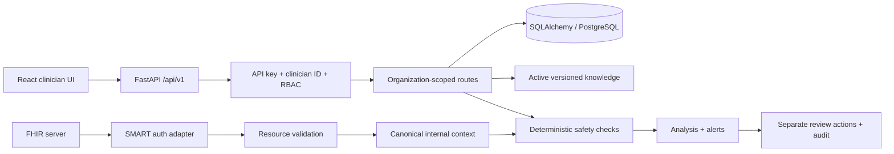

# Architecture

MediSafe AI is a production-oriented clinical decision support prototype. **Clinical validation: not clinically validated.** Component status is specific to current code and does not imply deployment suitability.

## Runtime components

| Component | Status | Notes |
|---|---|---|
| React + Vite workflow | Implemented / partial | Structured prescription and review flow; some patient profile tabs have unavailable data APIs |
| FastAPI routes | Implemented / partial | API key + clinician ID identity boundary; no external identity provider |
| SQLAlchemy persistence | Implemented | PostgreSQL intended; synthetic tests use SQLite |
| Alembic migrations | Implemented | Verify clean and copied existing DB before each release |
| Versioned knowledge lifecycle | Implemented / partial | Lifecycle exists; v1 prototype data has not been clinically reviewed |
| Deterministic safety engine | Partial / not clinically validated | Small ruleset and incomplete clinical context |
| FHIR adapter | Partial | Documented fields only, validation precedes normalization |
| SMART client | Partial | PKCE and expiry support, process-memory token state |
| Audit trail | Implemented / partial | API action records exist; no tamper-evident external audit sink |

## Request path

Every FHIR resource used in analysis is validated and normalized by the versioned adapter. A malformed resource yields a validation error; stale or unavailable context is exposed as a data-quality limitation. No external source bypasses this boundary.

## Persistence and decisions

Organization/user/role records define the access boundary. Patient records and clinical lists are linked to organizations. Prescription drafts and medication orders capture entered values, normalized status, match method, and clinician confirmation. An analysis stores status, checked and unchecked domains, the knowledge version, rule set version, and data-quality output. Alerts reference that snapshot. Review actions and feedback are separate rows, so a later clinician decision does not rewrite the original alert. Audit rows record actor, action, target, timestamp, and version identifiers.

Knowledge payloads are imported from files or trusted sources, validated, normalized, checksummed, versioned, clinically reviewed, then activated by a reviewer. Activation and rollback are audited. Analysis records retain the version identifier used at decision time.

## Interfaces

Primary route groups include `/auth/session`, `/patients`, `/prescriptions`, `/prescriptions/{id}/confirm-normalization`, `/prescriptions/{id}/analyze`, `/alerts/{id}/actions`, `/alerts/{id}/feedback`, `/alerts/review-queue`, `/knowledge/*`, `/fhir/analyze`, `/fhir/smart/*`, `/system/status`, and `/api/health`. OpenAPI is served by FastAPI at `/docs` in development. Role requirements are enforced in backend dependencies.

## Failure behavior

An absent active knowledge version or failed normalization prevents a complete analysis. Analysis states distinguish `COMPLETE`, `PARTIALLY_EVALUATED`, `INCOMPLETE`, and `FAILED`, with checked and unchecked domains. Missing values are not converted into normal findings. Current behavior and limitations should be checked against [CLINICAL_SAFETY.md](CLINICAL_SAFETY.md) and [PROGRESS.md](PROGRESS.md).

## Deployment boundary

Docker Compose exists but requires validation: the configured backend Dockerfile path does not match the observed repository location. Local dev commands are documented in [README.md](../README.md). Production deployment, high availability, encrypted token storage, external audit export, and validated operational controls are planned.
