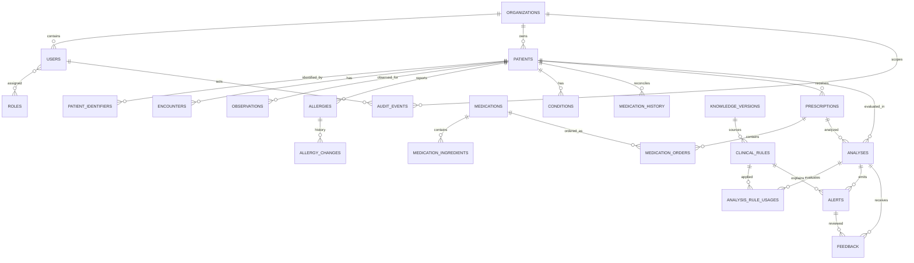

# Normalized Data Model

**Status:** Production-oriented clinical decision support prototype. Schema and migrations are implemented; migration behavior must be rechecked per release. The schema is a technical data model, not evidence of clinical validation or authorization for real-patient use.

## Design Principles

- Clinical records use integer primary keys, explicit foreign keys, relationship indexes, organization-scoped uniqueness where identifiers are tenant-owned, and `RESTRICT` deletion behavior.
- Mutable clinical entities carry creation/update timestamps and actor IDs plus soft-deactivation metadata. Application-level SQLAlchemy session hooks reject hard deletion of records using the soft-delete mixin.
- `audit_events`, allergy change entries, and analysis-rule usage entries are append-only in the application ORM. The audit event model has no update timestamp; its actor, entity reference, action, timestamp, and structured details are recorded on insert.
- Unknown clinical facts are represented by enumerated status values and nullable values, never by inferred `false`, zero, or empty text. Absence of a row is not equivalent to a negative clinical finding.
- Every analysis starts as `INCOMPLETE`, and each safety domain starts unchecked. A caller must explicitly record which domains were evaluated. These schema fields do not themselves prove that a checker ran correctly.
- There are no clinical-rule or medication-catalog seed rows. Clean installs include a default organization, role names, and the version 1 prototype knowledge file as `REVIEW_PENDING`; it is never active until a clinical reviewer signs off.

## Implementation Status

| Data slice | Status | Notes |
|---|---|---|
| Organizations, users, roles, and clinician authorization links | Implemented / partial | Backend role and tenant checks exist; user authentication is still a shared API credential plus clinician ID. |
| Legacy patient demographics, allergies, conditions, and current medications | Implemented / partial | Used by the main workflow; freshness and clinical verification are mostly unavailable. |
| Normalized allergy, condition, observation, encounter, and medication history entities | Implemented / partial | Schema and migrations exist; not every entity has complete CRUD/read UI/API coverage. |
| Medication catalog, prescriptions, and medication orders | Implemented / partial | Structured drafts and normalization review are implemented; terminology coverage is limited. |
| Analysis, alerts, separate review decisions, feedback, and audit | Implemented / partial | Decision snapshots and audit are persisted; audit storage is not tamper-evident. |
| Versioned knowledge and rule provenance | Implemented / partial | Lifecycle and rollback are implemented; prototype version 1 still awaits clinical review. |
| FHIR resource context | Partial | Only fields in [FHIR_INTEGRATION.md](FHIR_INTEGRATION.md) map into the canonical model. |
| Clinical validity of stored rules or data | Not clinically validated | Software schema and tests are not clinical evidence. |

## Entity Inventory

| Entity/table | Purpose and important fields |
|---|---|
| `organizations` | Tenant boundary and lifecycle (`name`, active/deactivated state, created/updated actor/time). A default organization is seeded for compatibility with the existing single-tenant prototype. |
| `users` | Organization-scoped identity (`email`, normalized email, display name, active state); timestamps and actor/deactivation metadata. Credentials/authentication are deliberately outside this schema implementation. |
| `roles` | Named authorization roles; clean install inserts `ADMIN`, `DOCTOR`, `PHARMACIST`, `CLINICAL_REVIEWER`, `READ_ONLY`. |
| `user_roles` | Composite `(user_id, role_id)` association with FKs and record metadata. |
| `patients` | Existing legacy table and ID preserved; now includes organization FK, timestamps/actors, soft deactivation, and explicit allergy-data, renal-function, hepatic-function, and pregnancy statuses. Demographic values remain nullable legacy fields; no status is inferred from missing data. |
| `patient_identifiers` | Organization- and patient-scoped identifier values. Unique `(organization_id, identifier_type, normalized_value)` prevents duplicate MRNs within one organization. The model does not mint identifiers. |
| `encounters` | Patient/organization-linked clinical visit, with optional external ID, type, status, dates, and source. External IDs are unique within an organization when non-null. |
| `observations` | Coded patient/encounter observations with optional value/unit/time/source and `KNOWN`, `UNKNOWN`, or `NOT_AVAILABLE` status. A check constraint requires a value for `KNOWN` and prohibits a value for unknown/unavailable states. |
| `allergies` | Patient/encounter-linked allergy: substance, category, reaction, severity, clinical status, verification status (`CONFIRMED`, `SUSPECTED`, `HISTORICAL`, `UNKNOWN`, `NOT_AVAILABLE`), onset, notes, source, recorder and recorded time. Default statuses are unknown. |
| `allergy_changes` | Immutable before/after JSON snapshots for allergy creation and updates, with actor/time. SQLAlchemy session hooks create entries for ORM mutations; direct SQL writes bypass that application hook. |
| `conditions` | Patient/encounter-linked condition with name, optional code/code system, clinical status, onset, severity, source, and common lifecycle metadata. |
| `medications` | Medication catalog only: display/normalized name, optional concept code/code system, strength, dose form, route, catalog-data status, and source. Unique normalized name and unique non-null code-system/code pairs. Catalog presence does not assert patient use. |
| `medication_ingredients` | Medication-to-ingredient links, normalized ingredient identity, optional terminology code, strength, and source. Unique medication/normalized-ingredient pair. |
| `medication_history` | Patient medication reconciliation/history, distinct from an order: medication FK and name snapshot, explicit current/stopped/historical/unknown status, dose/frequency, indication, prescriber, source, start/end, and `last_verified_at`. Migrated legacy rows are `UNKNOWN` and unverified. |
| `prescriptions` | Existing legacy prescription table/IDs preserved, with organization and optional encounter links, explicit order and parser status/source plus lifecycle metadata. Existing raw text and legacy string `created_at` are retained. |
| `medication_orders` | A requested/ordered medication, distinct from catalog and history: patient/prescription/encounter, optional catalog FK and snapshot name, dose/unit/route/frequency/duration, indication, order status, prescriber, source, verification time, normalization status/confidence/method/message, and canonical result snapshot. Unique `legacy_item_id` makes import idempotent. New submissions remain `DRAFT`. |
| `knowledge_versions` | Immutable dataset/version payload with source/source version, effective date, last reviewed date, evidence reference, checksum, reviewer, activation actor/time, and lifecycle stage. Version 1 is explicitly prototype data and remains `REVIEW_PENDING` until reviewer sign-off. A partial unique index permits at most one active version per dataset. |
| `clinical_rules` | Versioned deterministic rule record with rule ID/version, source/source version, effective date, evidence reference, domain, severity, structured trigger conditions, rationale, recommendation, status, and optional knowledge-version FK. Rule ID/version is unique; source provenance fields are required. |
| `analyses` | Durable patient/prescription-linked analysis snapshot with `COMPLETE`, `PARTIALLY_EVALUATED`, `INCOMPLETE`, or `FAILED` status; failure reason; knowledge/rule-set versions; booleans for allergy, drug-drug, drug-disease, dose, duplicate-therapy, renal, hepatic, pregnancy, and age domains; extensible `other_domains`. All checked flags default false. Legacy analyses are imported as `INCOMPLETE`. |
| `analysis_rule_usages` | Append-only record of a rule/version used for a particular analysis and whether that evaluation was evaluated, not evaluated, or failed. Unique analysis/rule/version tuple. |
| `alerts` | Durable analysis-level alert with optional rule FK, original index, domain, severity/status, message, evidence/source/recommendation, structured details, acknowledgement actor/time, and override reason. Original alert row remains; state changes are explicit. |
| `feedback` | Analysis/optional-alert-linked reviewer feedback with explicit agree/disagree/override/unknown decision, note, submitter/time, and retained legacy feedback identifiers/fields. Legacy null decisions map to `UNKNOWN`, not disagreement. |
| `audit_events` | Append-only actor/organization and entity-referenced event with action, time, and structured details. No clinical text duplication is required by the model. ORM hooks reject mutation/deletion. |

## Relationship Outline

The existing `patient_allergies`, `patient_conditions`, `patient_medications`, `prescription_items`, and `alert_feedback` tables remain as compatibility/source records after migration. New normalized records link back to legacy IDs where available; the original rows are not deleted.

## Prescription Authoring and Terminology

- `TerminologyProvider` is the interface. Local normalization uses the active knowledge payload. `ExternalTerminologyProvider` is an unconfigured RxNorm/jurisdiction adapter stub and returns `NOT_AVAILABLE` without making up an identifier.
- The current local JSON supplies display names, some active-ingredient names, and therapeutic classes. It has no concept identifiers, product strengths, dose forms, or routes. Canonical responses preserve that source: unavailable codes/forms/strength/routes are `null`; no RxCUI is synthesized.
- Results include `canonical_entity`, `confidence`, `match_method`, `status`, provider, and review message. Exact names score 1.0; exact ingredient aliases score 0.98; fuzzy matching requires at least 0.95 and is rejected as ambiguous when near-tied candidates exist. Unavailable, unknown, ambiguous, and below-threshold input never silently selects a candidate; review cases use the exact message “Medication could not be confidently normalized”.
- `POST /api/v1/prescriptions` and `GET /api/v1/prescriptions/{id}` require API-key plus clinician identity and an authorized role. Structured input requires medication name, positive numeric dose, supported unit, route, and frequency; invalid values return 422. Duration and indication are optional nullable details.
- Natural-language input is parsed only into exact local-name mentions and saved as `DRAFT`. Missing drug mentions return `MANUAL_ENTRY_REQUIRED` with no guessed order. Parsed route is unavailable and stays null; all drafts require clinician review. The legacy `/prescriptions/analyze` endpoint now uses exact draft parsing, rejects failed normalization and item-only requests, and never marks the prescription active.
- Prescription creation and each normalization outcome create append-only `audit_events` containing IDs, parser/status, confidence, match method, and provider. Raw medication text and indication are deliberately omitted from event details.
- No LLM is used. Therefore there is no model/prompt metadata; if an LLM is introduced later, schema validation and model/version/prompt-version logging are required before accepting output.
- `POST /api/v1/prescriptions/{id}/confirm-normalization` records clinician confirmation for a normalized order. `POST /api/v1/prescriptions/{id}/analyze` persists an analysis snapshot only after required normalization confirmation. The API key plus caller-supplied clinician ID is still a prototype access boundary, not strong proof of individual identity.

## Review, Feedback, and Audit Records

| Entity/table | Purpose and important fields |
|---|---|
| `analyses` | Immutable evaluation snapshot with status, checked/unchecked domains, data-quality output, rule-set version and knowledge-version FK. |
| `alerts` | Analysis output with severity, message, domain, rule reference/version snapshot and status. The alert is retained when a clinician acts. |
| `alert_review_actions` | Separate review/acknowledge/override/resolve/dismiss decisions with clinician, timestamp, optional note, structured severe override reason, rule version and knowledge version. |
| `feedback` | Analysis/alert/clinician decision and rationale with rule and knowledge version. Feedback informs analytics and review only; it does not mutate clinical rules. |
| `audit_events` | Actor and organization, action, target type/ID, timestamp and structured version/action metadata. Current DB rows are not tamper-evident against privileged database edits. |

Clinical validation: **not clinically validated**. The existing rule set and knowledge version 1 remain prototype data pending reviewer sign-off. See [CLINICAL_SAFETY.md](CLINICAL_SAFETY.md).

## Constraints and Indexing

- FKs use `RESTRICT` for organization, patient, user, encounter, medication, prescription, analysis, rule, knowledge, and alert references. Clinical deletion is represented by `is_active = false` plus deactivation actor/time.
- Unique keys: role name; organization name; organization/email; organization-scoped patient identifier; organization/external encounter ID; medication normalized name and terminology code; medication ingredient; rule ID/version; knowledge dataset/version; analysis/rule/version; analysis alert index; legacy medication order ID; legacy feedback ID.
- Query indexes cover patient/active users, patient encounters, patient observation code/time, patient allergy/condition/medication status, medication lookup, patient prescription/analysis history, rule status/domain, alert severity, and feedback analysis/alert.
- `observations` has a value/status check constraint. Other clinical semantics are represented by enums and FKs; further validation should be added only with domain-owner agreement.

## Migration and Compatibility

- Alembic configuration is in `frontend/backend/alembic.ini`; versioned revisions are in `frontend/backend/migrations/versions/`. Backend startup runs `alembic upgrade head` against the configured engine. CLI use from `frontend/backend`: `python -m alembic upgrade head`.
- The initial revision has two paths. An empty database receives explicit clean-install DDL plus a default organization and role names. An unversioned legacy database is detected by existing patient/prescription tables; new tables are created, old tables are altered additively, and existing allergies, conditions, current-medication rows, prescription items, prescriptions, and feedback are copied into normalized tables.
- Imported legacy verification, status, and missing-source fields remain unknown/unavailable. Legacy analysis rows are marked `INCOMPLETE`; no analysis domain is asserted checked. Medication names are catalog records with unknown source status.
- Existing legacy rows remain in their original tables. Migration acceptance tests compare row counts before/after and query only synthetic data or a temporary backup copy of the local dev database. The source dev DB is not modified by the test.
- The baseline migration intentionally refuses downgrade because dropping the new tables would destroy clinical records. Backups and a forward-only corrective revision are required for rollback/recovery.
- The current legacy API still uses legacy tables. Switching all reads/writes to normalized entities is a separate application/API migration; this schema work does not claim that existing workflows have been cut over.

## Governed Knowledge Lifecycle

- `frontend/knowledge_base/versions/v1.json` contains the migrated graph, provenance manifest, explicit unreviewed status, and SHA-256 checksum. The database migration stores its payload as version 1 without activating it.
- `POST /api/v1/knowledge/import` accepts a JSON file as the raw request body. It runs `IMPORT -> VALIDATE -> NORMALIZE -> VERSION`, checks the checksum and required record fields, and only accepts sources listed in `TRUSTED_KNOWLEDGE_SOURCES` (comma-separated). It does not fetch remote content.
- `POST /api/v1/knowledge/{id}/review` requires `CLINICAL_REVIEWER` or `ADMIN` and records reviewer, review date, note, and audit event. Activation is limited to reviewer/admin after sign-off.
- `POST /api/v1/knowledge/{id}/activate` and `/rollback` require the caller to provide `expected_active_version_id`, including explicit `null` when no version is active. A mismatched expectation returns 409; switching versions emits an audit event. Prior versions remain stored for rollback.
- Analysis routes load only the active `medisafe-clinical` payload. They return 503 when none is active and persist the selected `knowledge_version_id`, version, checksum, and rule-set version on normalized `analyses`. Reevaluation uses the version originally recorded on the analysis.
- Decision-path knowledge requests to RxNorm/openFDA are disabled. Trusted sources must be imported as files and reviewed before activation.
